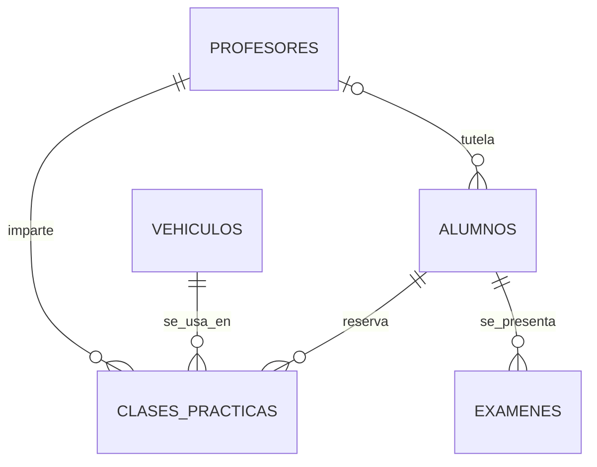

# SIMULACRO DE EXAMEN — AUTOESCUELA (ALUMNADO)

**Módulo:** Acceso a datos / Persistencia con Java  
**Tecnologías:** Java 21, Maven, SQLite, JPA/Hibernate y SQL  
**Objetivo:** completar las entidades JPA con sus relaciones, desarrollar 5 DAO y resolver 20 retos SQL y 4 operaciones transaccionales sobre una base relacional, con salidas de referencia.

> **Versión de alumnado:** los DAO, parte de las entidades y `consultas.sql` contienen `TODO`. Los ejemplos de salida son expectativas comprobables, **no soluciones SQL**. No se incluye una batería oficial de nota ni se simula que esté disponible.
>
> **Duración del simulacro:** este enunciado es casi el doble de largo que el examen previsto (5 DAO, 20 consultas y 4 operaciones). A los **105 minutos** se hace una copia del proyecto y se corrige tal como esté: esa es la nota de examen. Después se sigue hasta terminarlo y se vuelve a corregir. Conviene repartir el tiempo como en el examen: lo que arranca la unidad de persistencia y el CRUD primero; lo más difícil, al final.

## 1. Contexto y trabajo a entregar

Una autoescuela controla **profesores, vehículos, alumnos, clases prácticas y exámenes**. Debe organizar la agenda de clases, impedir que un profesor o un vehículo estén en dos clases a la vez, cancelar reservas, dar de baja alumnos, registrar los resultados de los exámenes y elaborar estadísticas de ingresos. Son **5 tablas**.

Debes completar las entidades a partir de `schema.sql`, con sus relaciones; implementar los métodos sin resolver en los DAO; escribir las 20 consultas en `consultas.sql` (C01…C20) y los pasos de las operaciones C21…C24; y documentar los métodos públicos con Javadoc. Mantén `modelo`, `orm/entity` y `orm/mapper` separados; implementa persistencia directamente desde los DAO mediante `EntityManager`. Para las consultas de varios campos (`List<Object[]>`), respeta exactamente el orden de columnas descrito abajo.

## 2. Modelo relacional



| Tabla | Clave primaria | Columnas principales y relaciones |
|---|---|---|
| `profesores` | `id_profesor` | `nombre`, `dni` (único), `telefono` (puede ser NULL), `activo` (0/1) |
| `vehiculos` | `matricula` (texto, la escribe quien inserta) | `marca`, `modelo`, `tipo`, `anio` |
| `alumnos` | `id_alumno` | `nombre`, `email` (único), `fecha_alta`, `id_profesor` → `profesores` (tutor; **puede ser NULL**), `activo` (0/1) |
| `clases_practicas` | `id_clase` | `id_alumno` → `alumnos`, `id_profesor` → `profesores`, `matricula` → `vehiculos`, `fecha`, `hora`, `duracion_min` (>0), `precio` (≥0), `estado` |
| `examenes` | `id_examen` | `id_alumno` → `alumnos`, `tipo`, `fecha`, `resultado`, `errores` (≥0; NULL mientras está pendiente) |

**Restricciones:** `vehiculos.tipo` ∈ `COCHE`, `MOTO`, `CAMION`; `clases_practicas.estado` ∈ `RESERVADA`, `REALIZADA`, `CANCELADA`; `examenes.tipo` ∈ `TEORICO`, `PRACTICO`; `examenes.resultado` ∈ `PENDIENTE`, `APTO`, `NO_APTO`. Los importes son euros, las fechas `YYYY-MM-DD` y las horas `HH:MM`. Activa `PRAGMA foreign_keys=ON` **por conexión**. Todas las FK restringen el borrado si tienen referencias.

### Convenciones de consulta (obligatorias)

- **Clase activa:** la que no está `CANCELADA` (`RESERVADA` o `REALIZADA`). Las canceladas no ocupan agenda ni cuentan en los recuentos de clases.
- **Clase facturada:** la `REALIZADA`. Los ingresos de un profesor o de un vehículo, y el gasto de un alumno, suman el `precio` de sus clases facturadas.
- Los recuentos que indican *incluidos los de cero* deben mostrar filas sin relaciones (`LEFT JOIN`/subconsulta equivalente).
- Los empates se resuelven por las columnas de orden indicadas; no uses orden implícito.
- `precio` es `NUMERIC` (`BigDecimal` en Java). Si una consulta que compara una suma de importes con un parámetro devuelve 0 filas **sin dar ningún error**, el fallo es de tipos, no de la consulta: el driver de SQLite envía un parámetro `BigDecimal` como texto, y SQLite considera cualquier número menor que cualquier texto.
- Las salidas se refieren a los **datos iniciales sin modificar**, salvo C21-C24, que son casos de prueba independientes y deben ejecutarse desde una copia de la base inicial.

## 3. Estructura y ejecución

```text
autoescuela-alumnado/
├── README.md
├── consultas.sql                 # C01…C20 y pasos de C21…C24, para completar
├── datos/autoescuela.sqlite3     # Base de ejemplo ya creada
├── pom.xml
└── src/
    ├── main/
    │   ├── java/es/ejemplo/autoescuela/
    │   │   ├── modelo/             # 5 clases POJO
    │   │   ├── dao/                # 5 DAO con TODO
    │   │   ├── orm/entity/         # 5 entidades JPA
    │   │   ├── orm/mapper/         # 5 mappers
    │   │   ├── orm/config/         # Factoría EntityManagerFactory
    │   │   └── app/                # Main para comprobaciones
    │   └── resources/
    │       ├── schema.sql
    │       ├── datos_iniciales.sql
    │       └── META-INF/persistence.xml
    └── test/java/es/ejemplo/autoescuela/
        └── ProfesorDaoTest.java    # 3 pruebas de ejemplo
```

Para comenzar: `mvn test` (requiere Maven y JDK 21). El proyecto contiene **esqueletos para resolver**: compila tal cual, pero las 3 pruebas de `ProfesorDaoTest` fallan, y compilar no demuestra que se hayan realizado las consultas. Puedes abrir `datos/autoescuela.sqlite3` con SQLite y ejecutar allí SQL sobre una **copia** para no alterar las salidas de referencia. Para reconstruir la base desde cero, ejecuta `schema.sql` y después `datos_iniciales.sql` sobre una base vacía.

### Contrato general DAO

Cada DAO proporciona `listar`, `buscarPorId`, `insertar`, `actualizar`, `eliminar`; hay además métodos específicos listados en el código y en las consultas. `listar` devuelve todas las filas ordenadas por la clave primaria. Las operaciones CRUD deben devolver el `id` generado (> 0) al insertar, `1` al actualizar o eliminar y `0` si no procede. **Excepción:** `VehiculoDao.insertar` devuelve `1`, porque la matrícula es una clave natural que no genera la base. `actualizar` guarda todos los campos del objeto recibido salvo la clave primaria, también las claves foráneas, y nunca inserta un registro que no existe. Una búsqueda sin coincidencias devuelve `Optional.empty()`; listas sin resultados, lista vacía. `buscarPorDni` y `buscarPorEmail` buscan por el valor exacto. Maneja errores de persistencia registrándolos dentro del DAO, sin propagarlos en sus API. Utiliza `EntityManager` y consultas parametrizadas en JPQL; abre y cierra cada contexto y aplica `begin`/`commit`/`rollback` en escrituras. Las restricciones deben comprobarse tanto en la lógica de negocio como en la BD cuando corresponda.

Datos que no proceden (`insertar` y `actualizar` devuelven `0`; «vacío» es `null` o solo espacios):

| DAO | Devuelve `0` si… |
|---|---|
| `ProfesorDao` | `nombre` o `dni` vacíos; `activo` distinto de 0 y 1; el `dni` ya es de otro profesor |
| `VehiculoDao` | `matricula`, `marca` o `modelo` vacíos; `tipo` fuera de su lista; `anio` nulo; al insertar, la matrícula ya existe |
| `AlumnoDao` | `nombre`, `email` o `fechaAlta` vacíos; `activo` distinto de 0 y 1; el `email` ya es de otro alumno; se indica un tutor (`idProfesor`) que no existe. Sin tutor (`null`) es válido |
| `ClasePracticaDao` | falta `idAlumno`, `idProfesor` o `matricula`, o alguno no existe; `fecha` u `hora` vacías; `duracionMin` ≤ 0; `precio` nulo o negativo; `estado` fuera de su lista |
| `ExamenDao` | `idAlumno` inexistente; `tipo` o `resultado` fuera de su lista; `fecha` vacía; `errores` negativo (`null` es válido) |

Un `null` en `activo`, `tipo`, `estado` o `resultado` cuenta como valor fuera de su lista y devuelve `0`: no se aplica el `DEFAULT` de `schema.sql`.

### Entidades y relaciones

Las entidades de `orm/entity` usan los tipos de columna que acepta la validación con SQLite: `INTEGER` → `Integer`, `TEXT` → `String`, `NUMERIC` → `BigDecimal`. Las claves foráneas se mantienen también como campos escalares (`idProfesor`, `idAlumno`, `matricula`) con su columna: son las que se escriben al insertar y al actualizar, y las que copian los mappers.

`ExamenEntity` ya tiene sus campos, su constructor vacío, getters y setters, pero **está sin anotar**: hay que anotarla a partir de `schema.sql` y añadirle su relación.

Las relaciones se mapean **en los dos lados**, con estos atributos y nombres obligatorios:

| Entidad | Atributo | Tipo | Relación |
|---|---|---|---|
| `AlumnoEntity` | `tutor` | `ProfesorEntity` | muchos a uno sobre `id_profesor` |
| `AlumnoEntity` | `clases` | `List<ClasePracticaEntity>` | uno a muchos, inversa de `alumno` |
| `AlumnoEntity` | `examenes` | `List<ExamenEntity>` | uno a muchos, inversa de `alumno` |
| `ClasePracticaEntity` | `alumno` | `AlumnoEntity` | muchos a uno sobre `id_alumno` |
| `ClasePracticaEntity` | `profesor` | `ProfesorEntity` | muchos a uno sobre `id_profesor` |
| `ClasePracticaEntity` | `vehiculo` | `VehiculoEntity` | muchos a uno sobre `matricula` |
| `ExamenEntity` | `alumno` | `AlumnoEntity` | muchos a uno sobre `id_alumno` |
| `ProfesorEntity` | `alumnos` | `List<AlumnoEntity>` | uno a muchos, inversa de `tutor` |
| `ProfesorEntity` | `clases` | `List<ClasePracticaEntity>` | uno a muchos, inversa de `profesor` |
| `VehiculoEntity` | `clases` | `List<ClasePracticaEntity>` | uno a muchos, inversa de `vehiculo` |

- Lado «muchos a uno»: carga perezosa (`LAZY`) y de solo lectura sobre la misma columna que la FK escalar, que sigue siendo la que se escribe.
- Lado «uno a muchos»: lado inverso, también con carga perezosa (la que tiene por defecto), y con la lista ya creada (vacía) al construir la entidad.
- Cada relación, con su getter.
- `persistence.xml` usa `hibernate.hbm2ddl.auto=validate`: al arrancar, Hibernate compara cada entidad con su tabla y, si una columna o un tipo no coinciden, no arranca ningún DAO.
- Comprueba que todas las entidades están registradas en la unidad de persistencia.

## 4. Retos SQL y resultados esperados

Cada reto especifica **tablas**, entradas (parámetros), **columnas exactas** y **ordenación**. En Java se resuelve con JPQL en el método del DAO que le corresponde, y en `consultas.sql`, en SQL con los valores de ejemplo. Los ejemplos muestran las primeras filas salvo que se indique lo contrario; `∅` significa que no hay resultados. No se muestra SQL resuelto. En consultas con agregaciones usa el alias funcional de las columnas indicado. Los importes se muestran con dos decimales (`30.00`); en Java pueden salir como `30` o `30.0`, y no es un error.

### C01. Alumnos activos

**Tablas:** `alumnos`. **Parámetros:** ninguno.  
**Salida:** `nombre, email`. **Orden:** nombre ASC.

```text
nombre | email
Ana Torres | ana@autoescuela.es
Bruno Gil | bruno@autoescuela.es
Carla Vega | carla@autoescuela.es
David León | david@autoescuela.es
Elena Ramos | elena@autoescuela.es
```
**Total real:** 9 filas; se muestran las 5 primeras.

### C02. Vehículos de un tipo, del más nuevo al más antiguo

**Tablas:** `vehiculos`. **Parámetros:** tipo = COCHE.  
**Salida:** `matricula, marca, modelo, anio`. **Orden:** anio DESC, matricula ASC.

```text
matricula | marca | modelo | anio
5678-MNP | Toyota | Yaris | 2023
1234-KLM | Seat | Ibiza | 2021
9012-PRS | Renault | Clio | 2019
```

### C03. Alumnos cuyo nombre contiene un texto, sin distinguir mayúsculas

**Tablas:** `alumnos`. **Parámetros:** texto = ra.  
**Salida:** `nombre, email`. **Orden:** nombre ASC.

```text
nombre | email
Elena Ramos | elena@autoescuela.es
Fran Ortega | fran@autoescuela.es
Irene Mora | irene@autoescuela.es
```

### C04. Agenda de un día (clases activas)

**Tablas:** `clases_practicas + alumnos + profesores`. **Parámetros:** fecha = 2026-11-12.  
**Salida:** `id_clase, hora, alumno, profesor, matricula`. **Orden:** hora, id_clase ASC.

```text
id_clase | hora | alumno | profesor | matricula
14 | 09:00 | Ana Torres | Laura Medina | 1234-KLM
16 | 10:00 | Fran Ortega | Marta Santana | 9012-PRS
17 | 11:00 | Irene Mora | Pablo Ruiz | 3456-TVW
15 | 18:00 | Ana Torres | Pablo Ruiz | 5678-MNP
```

### C05. Clases activas entre dos fechas, ambas incluidas

**Tablas:** `clases_practicas + alumnos`. **Parámetros:** desde = 2026-11-13; hasta = 2026-11-14.  
**Salida:** `fecha, hora, alumno, estado`. **Orden:** fecha, hora ASC.

```text
fecha | hora | alumno | estado
2026-11-13 | 09:00 | Carla Vega | RESERVADA
2026-11-13 | 10:00 | Elena Ramos | RESERVADA
2026-11-14 | 11:00 | David León | RESERVADA
```

### C06. Alumnos con su tutor, también los que no tienen

**Tablas:** `alumnos + profesores`. **Parámetros:** ninguno.  
**Salida:** `alumno, tutor (NULL si no tiene)`. **Orden:** alumno ASC.

```text
alumno | tutor
Ana Torres | Laura Medina
Bruno Gil | Laura Medina
Carla Vega | Pablo Ruiz
David León | Pablo Ruiz
Elena Ramos | Marta Santana
```
**Total real:** 10 filas; se muestran las 5 primeras.

### C07. Alumnos tutelados por cada profesor, incluidos los de cero

**Tablas:** `profesores + alumnos`. **Parámetros:** ninguno.  
**Salida:** `profesor, alumnos`. **Orden:** alumnos DESC, profesor ASC.

```text
profesor | alumnos
Laura Medina | 3
Pablo Ruiz | 3
Marta Santana | 2
Jorge Déniz | 0
```

### C08. Clases activas por profesor, incluidos los de cero

**Tablas:** `profesores + clases_practicas`. **Parámetros:** ninguno.  
**Salida:** `profesor, clases`. **Orden:** clases DESC, profesor ASC.

```text
profesor | clases
Laura Medina | 7
Pablo Ruiz | 7
Marta Santana | 5
Jorge Déniz | 0
```

### C09. Ingresos por vehículo, incluidos los de cero

**Tablas:** `vehiculos + clases_practicas`. **Parámetros:** ninguno.  
**Salida:** `matricula, ingresos`. **Orden:** ingresos DESC, matricula ASC.

```text
matricula | ingresos
1234-KLM | 120.00
9012-PRS | 70.00
5678-MNP | 60.00
3456-TVW | 28.50
7890-XYZ | 0.00
```

### C10. Historial de clases de un alumno, en todos los estados

**Tablas:** `clases_practicas + profesores`. **Parámetros:** id_alumno = 1.  
**Salida:** `fecha, hora, profesor, matricula, estado`. **Orden:** fecha, hora ASC.

```text
fecha | hora | profesor | matricula | estado
2026-11-09 | 09:00 | Laura Medina | 1234-KLM | REALIZADA
2026-11-10 | 09:00 | Laura Medina | 1234-KLM | REALIZADA
2026-11-12 | 09:00 | Laura Medina | 1234-KLM | RESERVADA
2026-11-12 | 18:00 | Pablo Ruiz | 5678-MNP | RESERVADA
```

### C11. Exámenes de un alumno

**Tablas:** `examenes`. **Parámetros:** id_alumno = 2.  
**Salida:** `tipo, fecha, resultado, errores`. **Orden:** fecha, id_examen ASC.

```text
tipo | fecha | resultado | errores
TEORICO | 2026-10-15 | NO_APTO | 5
TEORICO | 2026-10-29 | APTO | 1
```

### C12. Presentados y aptos por tipo de examen (presentado: resultado distinto de PENDIENTE)

**Tablas:** `examenes`. **Parámetros:** ninguno.  
**Salida:** `tipo, presentados, aptos`. **Orden:** tipo ASC.

```text
tipo | presentados | aptos
PRACTICO | 2 | 1
TEORICO | 9 | 6
```

### C13. Alumnos sin ninguna clase, en ningún estado

**Tablas:** `alumnos + clases_practicas`. **Parámetros:** ninguno.  
**Salida:** `nombre, email`. **Orden:** nombre ASC.

```text
nombre | email
Héctor Cruz | hector@autoescuela.es
Javier Luján | javier@autoescuela.es
```

### C14. Vehículos sin ninguna clase RESERVADA

**Tablas:** `vehiculos + clases_practicas`. **Parámetros:** ninguno.  
**Salida:** `matricula, marca`. **Orden:** matricula ASC.

```text
matricula | marca
7890-XYZ | Iveco
```

### C15. Alumnos, activos o no, con al menos un mínimo de clases facturadas

**Tablas:** `alumnos + clases_practicas`. **Parámetros:** minimo = 2.  
**Salida:** `alumno, realizadas`. **Orden:** realizadas DESC, alumno ASC.

```text
alumno | realizadas
Ana Torres | 2
Carla Vega | 2
```

### C16. Ranking de profesores por ingresos (solo los que tienen clases facturadas)

**Tablas:** `profesores + clases_practicas`. **Parámetros:** limite = 2; si limite ≤ 0, lista vacía.  
**Salida:** `profesor, realizadas, ingresos`. **Orden:** ingresos DESC, profesor ASC.

```text
profesor | realizadas | ingresos
Laura Medina | 4 | 120.00
Pablo Ruiz | 3 | 88.50
```

### C17. Alumnos listos para el práctico: algún TEORICO APTO y ningún PRACTICO APTO

**Tablas:** `alumnos + examenes`. **Parámetros:** ninguno.  
**Salida:** `nombre, email`. **Orden:** nombre ASC.

```text
nombre | email
Ana Torres | ana@autoescuela.es
Bruno Gil | bruno@autoescuela.es
David León | david@autoescuela.es
Elena Ramos | elena@autoescuela.es
Fran Ortega | fran@autoescuela.es
```

### C18. Alumnos con más clases activas que la media de los diez alumnos (incluidos los de cero clases)

**Tablas:** `alumnos + clases_practicas`. **Parámetros:** ninguno.  
**Salida:** `alumno, clases`. **Orden:** clases DESC, alumno ASC.

```text
alumno | clases
Ana Torres | 4
Carla Vega | 3
David León | 3
Irene Mora | 3
Bruno Gil | 2
```
**Total real:** 6 filas; se muestran las 5 primeras.

### C19. Gasto de cada alumno activo, incluidos los de cero

**Tablas:** `alumnos + clases_practicas`. **Parámetros:** ninguno.  
**Salida:** `alumno, realizadas, gasto`. **Orden:** gasto DESC, alumno ASC.

```text
alumno | realizadas | gasto
Ana Torres | 2 | 60.00
Carla Vega | 2 | 60.00
Elena Ramos | 1 | 40.00
Bruno Gil | 1 | 30.00
Irene Mora | 1 | 30.00
```
**Total real:** 9 filas; se muestran las 5 primeras.

### C20. Alumnos, activos o no, con un gasto mayor que un mínimo

**Tablas:** `alumnos + clases_practicas`. **Parámetros:** minimo = 50.  
**Salida:** `alumno, gasto`. **Orden:** gasto DESC, alumno ASC.

```text
alumno | gasto
Ana Torres | 60.00
Carla Vega | 60.00
```

## 5. Reglas de negocio y transacciones (C21-C24)

Cada operación se hace en **una sola transacción**: las comprobaciones y la escritura van dentro del mismo `begin`…`commit`. Si algo no se cumple, `rollback` y `0`. **Importante:** comprobar e insertar dentro de la misma transacción; un `SELECT` fuera de ella puede producir dos reservas para el mismo hueco. Los ejemplos se ejecutan, cada uno, sobre una **copia nueva** de la base inicial.

**C21 — `ClasePracticaDao.reservarClase(idAlumno, idProfesor, matricula, fecha, hora)`:** devuelve el **id** de la clase nueva, o `0`. Condiciones:
- `fecha` y `hora` no vacías;
- alumno existente y activo;
- profesor existente y activo;
- vehículo existente;
- el profesor no tiene otra clase activa (no `CANCELADA`) a esa fecha y hora, y el vehículo tampoco;
- el alumno tiene **menos de 2** clases activas ese día.

La clase se crea con `duracion_min` 45, `estado` `RESERVADA` y el precio según el tipo de vehículo: `COCHE` 30.00, `MOTO` 28.50, `CAMION` 45.00.

| Llamada | Resultado | Motivo |
|---|---|---|
| `(8, 3, "7890-XYZ", "2026-11-20", "10:00")` | `23` | clase nueva; el vehículo es un camión: precio 45.00 |
| `(6, 1, "9012-PRS", "2026-11-12", "09:00")` | `0` | Laura Medina ya tiene la clase 14 a esa hora |
| `(8, 3, "1234-KLM", "2026-11-12", "09:00")` | `0` | el vehículo está ocupado por la clase 14 |
| `(8, 3, "9012-PRS", "2026-11-11", "12:00")` | `23` | la clase 13 está `CANCELADA`, así que el hueco está libre |
| `(1, 3, "9012-PRS", "2026-11-12", "12:00")` | `0` | Ana Torres ya tiene las clases 14 y 15 ese día |
| `(7, 3, "7890-XYZ", "2026-11-20", "10:00")` | `0` | alumno inactivo |
| `(8, 4, "7890-XYZ", "2026-11-20", "10:00")` | `0` | profesor inactivo |
| alumno, profesor o vehículo inexistente | `0` | |

**C22 — `ClasePracticaDao.cancelarClase(idClase)`:** solo una clase `RESERVADA` pasa a `CANCELADA` → `1`. Una `REALIZADA`, una ya `CANCELADA` o una inexistente → `0`. No se borra la fila: debe quedar registro de la operación. Ejemplo: `cancelarClase(11)` → `1`; la segunda vez → `0`; `cancelarClase(1)` (`REALIZADA`) → `0`.

**C23 — `AlumnoDao.darDeBaja(idAlumno)`:** en **una** transacción, el alumno pasa a `activo = 0` y **todas** sus clases `RESERVADA` pasan a `CANCELADA` → `1`. Inexistente o ya inactivo → `0`. Ejemplo: `darDeBaja(1)` → `1`; las clases 14 y 15 de Ana Torres quedan `CANCELADA` y la 1 y la 6 (`REALIZADA`) no cambian. `darDeBaja(7)` → `0`, porque Gloria Sosa ya está inactiva.

**C24 — `ExamenDao.registrarResultado(idExamen, resultado, errores)`:** solo si el examen existe y está `PENDIENTE`, `resultado` es `APTO` o `NO_APTO` y `errores` ≥ 0 → actualiza `resultado` y `errores` → `1`. En otro caso → `0`. Ejemplos:
- `(12, "APTO", 1)` → `1`;
- `(12, "APTO", 1)` otra vez → `0`, ya no está `PENDIENTE`;
- `(1, "NO_APTO", 3)` → `0`, ya tenía resultado;
- `(13, "PENDIENTE", 0)` → `0`, resultado no válido.

## 6. Actividades de entrega

1. Completar las entidades y sus relaciones sin cambiar los nombres de clases y campos ya escritos ni sus tipos, y registrarlas donde corresponda. Completar los 5 DAO sin cambiar sus firmas públicas y escribir en `consultas.sql` una consulta numerada C01…C20 y los pasos/semántica transaccional para C21…C24. No es obligatorio que el SQL use la misma sintaxis que JPQL, pero debe producir los mismos resultados.
2. Añadir a cada método público de los DAO Javadoc con finalidad, parámetros, retorno y situaciones de error.
3. Verificar integridad: FK inexistentes (también el tutor), DNI y email duplicados, matrícula repetida, valores fuera de su lista, duración no positiva, precio o errores negativos, y borrado de profesores, alumnos o vehículos con referencias.
4. Probar C21-C24: reservas que chocan por profesor, vehículo o número de clases del día, cancelaciones, bajas y resultados de examen. Usar copias independientes de la base para las pruebas que alteren datos.

### Autoevaluación sugerida (crea tus test y verifica que el código construido funciona)

| Criterio | Peso sugerido |
|---|---:|
| Entidades y relaciones | 1,5 puntos |
| CRUD de los cinco DAO | 2,5 puntos |
| Consultas SQL/JPQL C01–C20 | 3,5 puntos |
| Transacciones e integridad C21–C24 | 1,5 puntos |
| Javadoc, limpieza y parametrización | 1 punto |
| **Total orientativo** | **10 puntos** |

Se trata de una propuesta de ponderación para repaso; no existe en este proyecto un `-Pnota` ni un sistema automatizado de calificación. **No modificar** el esquema ni los datos de partida al contrastar el ejemplo.
