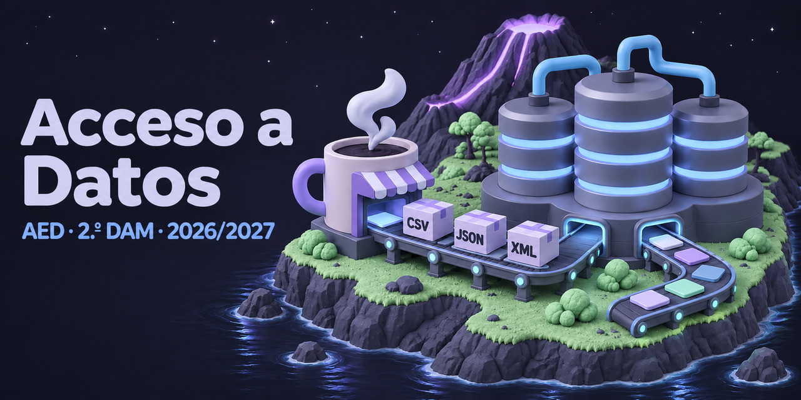

# Acceso a Datos (AED)


Repositorio con las actividades, prácticas y exámenes del módulo de Acceso a Datos durante 2.º DAM (curso 2026/2027). El curso sigue en marcha y se va completando según avanzan las clases.

## Contenido

### 1.er trimestre

| Actividad | Qué es |
| --- | --- |
| [Primer examen · Práctica de Maven](1er-trimestre/Primer%20Examen/proyecto-maven) | Compilación, dependencias y perfiles con Maven; [README](1er-trimestre/Primer%20Examen/proyecto-maven/README.md) con capturas. |
| [Primer examen · Ficheros](1er-trimestre/Primer%20Examen/ficheros) | Rutas con `Path` y `File`, recursos del proyecto y lectura de CSV con Commons CSV. |
| [Primer examen · Catálogo de productos](1er-trimestre/Primer%20Examen/catalogo-productos-repositorios) | CRUD de productos en CSV, JSON y XML con repositorios; [README](1er-trimestre/Primer%20Examen/catalogo-productos-repositorios/README.md). |
| [Primer examen · Preparación](1er-trimestre/Primer%20Examen/Preparacion%20del%20Examen) | Mis apuntes sobre lo que entra en el examen. |
| [Segundo examen · Repaso de SQLite](1er-trimestre/Segundo%20Examen/repaso-sqlite) | 30 consultas SQL sobre SQLite con autocorrector en Python; [enunciado](1er-trimestre/Segundo%20Examen/repaso-sqlite/ENUNCIADO.md). |
| [Segundo examen · Gestión con DAO](1er-trimestre/Segundo%20Examen/gestion-java-jdbc-dao) | Productos y vehículos con JDBC, SQLite y JUnit 5; [README](1er-trimestre/Segundo%20Examen/gestion-java-jdbc-dao/README.md). |
| [Segundo examen · Gestión con AbstractDao](1er-trimestre/Segundo%20Examen/gestion-java-jdbc-dao-abstractdao) | Misma gestión con clase padre `AbstractDao`; [README](1er-trimestre/Segundo%20Examen/gestion-java-jdbc-dao-abstractdao/README.md). |
| [Segundo examen · Anime tracker](1er-trimestre/Segundo%20Examen/anime-tracker-jdbc) | DAO, validador y servicio de series de anime con JDBC y SQLite; [README](1er-trimestre/Segundo%20Examen/anime-tracker-jdbc/README.md). |
| [Segundo examen · Academia](1er-trimestre/Segundo%20Examen/academia-cursos-alumnado) | 3 DAO con 22 métodos sobre `AbstractDao`, JDBC y SQLite; [README](1er-trimestre/Segundo%20Examen/academia-cursos-alumnado/README.md). |
| [Tercer examen · BiblioGest](1er-trimestre/Tercer%20Examen/bibliogest-alumnado) | Cinco DAO de una biblioteca con JPA/Hibernate y SQLite; [README](1er-trimestre/Tercer%20Examen/bibliogest-alumnado/README.md). |
| [Tercer examen · CineFest](1er-trimestre/Tercer%20Examen/cinefest-alumnado) | Siete DAO y 30 consultas SQL de un festival de cine con JPA; [README](1er-trimestre/Tercer%20Examen/cinefest-alumnado/README.md). |
| [Tercer examen · Taller mecánico](1er-trimestre/Tercer%20Examen/taller-mecanico-alumnado-orm) | Guía paso a paso de JDBC a JPA/Hibernate; [README](1er-trimestre/Tercer%20Examen/taller-mecanico-alumnado-orm/README.md). |
| [Tercer examen · Taller mecánico, práctica en casa](1er-trimestre/Tercer%20Examen/taller-mecanico-alumnado-orm-practica-en-casa) | Variante del taller para practicar en casa; [README](1er-trimestre/Tercer%20Examen/taller-mecanico-alumnado-orm-practica-en-casa/README.md). |
| [Cuarto examen · API de tareas](1er-trimestre/Cuarto%20Examen/api-tareas) | API REST de tareas con Spring Boot 4, Java 21 y repositorio CSV; [README](1er-trimestre/Cuarto%20Examen/api-tareas/README.md). |
| [Material extra](1er-trimestre/Material%20extra) | Simulacros de repaso de JDBC y ORM con tests; [índice](1er-trimestre/Material%20extra/README.md). |

### 2.º trimestre

Todavía no hay actividades.

### 3.er trimestre

Todavía no hay actividades.

## Estructura

```
1er-trimestre/
├── Primer Examen/     Maven, ficheros y repositorios
├── Segundo Examen/    SQLite, JDBC y DAO
├── Tercer Examen/     JPA / Hibernate
├── Cuarto Examen/     API REST con Spring Boot
└── Material extra/    simulacros de repaso
2do-trimestre/
3er-trimestre/
```

## Cómo ejecutar

Cada carpeta con un `pom.xml` es un proyecto Maven independiente. Desde la carpeta del proyecto:

```sh
mvn clean test
```

---

Diego Gil · 2.º DAM · 2026/2027
